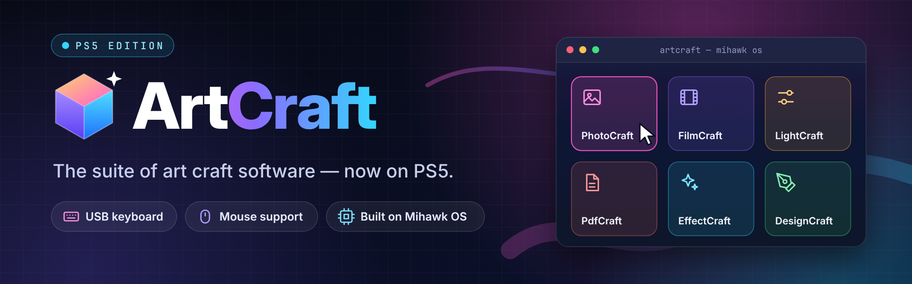
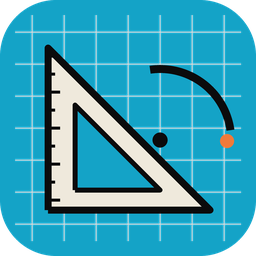
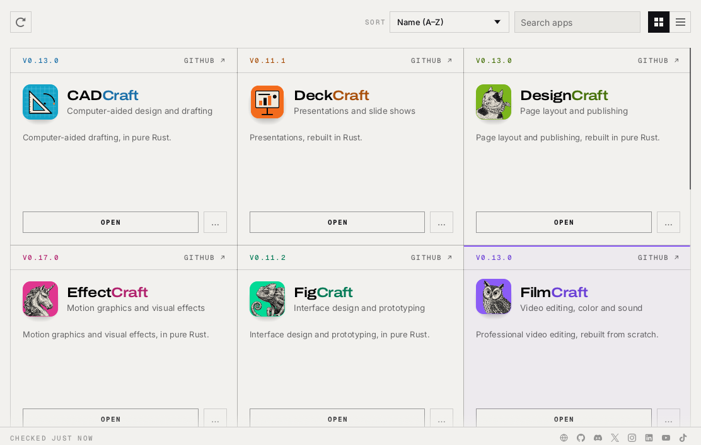
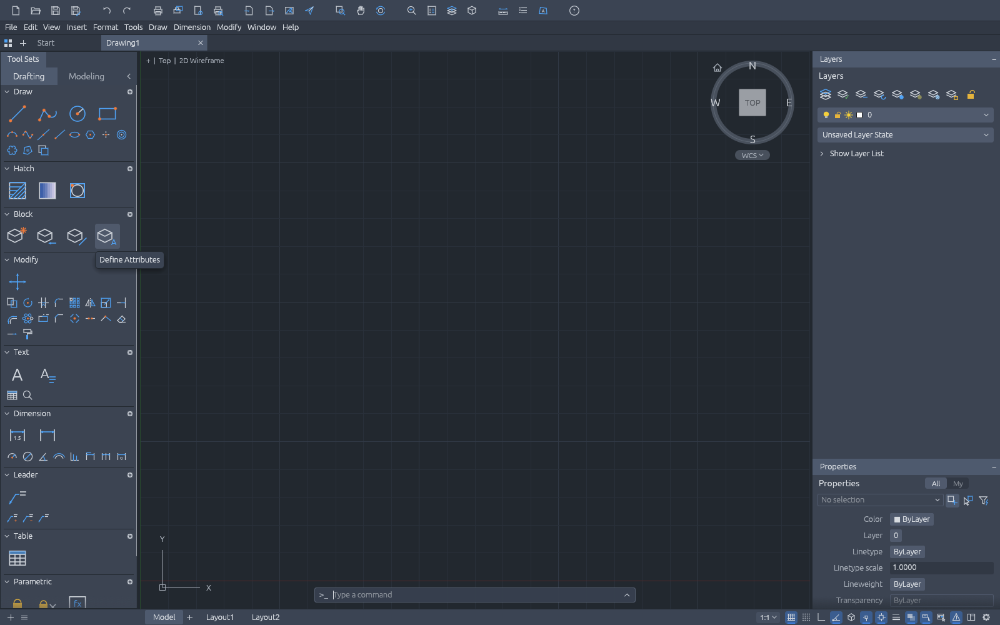

<p align="center">
  
</p>

<p align="center">
  
  
  <a href="https://github.com/premohq/PS5_MihawkOS"></a>
  <a href="#the-suite"></a>
  
  <a href="https://github.com/premohq/PS5-ARTCRAFT/actions/workflows/ci.yml"></a>
</p>

<p align="center">
  <b>PS5-ArtCraft</b> puts the Craft App Suite on a jailbroken PS5: PhotoCraft, VectorCraft, FilmCraft and ten more,<br>
  on a desktop of their own with a file manager, a USB keyboard and mouse, and ArtCraft Launcher starting by itself<br>
  and keeping itself and the apps up to date, as it does on a PC. Built on a fork of <a href="https://github.com/premohq/PS5_MihawkOS">Mihawk OS</a>,
  which runs Windows programs on the PS5 through Wine and Proton.
</p>

<p align="center">
  <a href="https://premohq.github.io/PS5-ARTCRAFT/"><b>Website</b></a> ·
  <a href="#build-it">Build it</a> ·
  <a href="#put-it-on-the-console">Put it on the console</a> ·
  <a href="#the-suite">The suite</a> ·
  <a href="#what-is-proven">What is proven</a> ·
  <a href="docs/ARCHITECTURE.md">Architecture</a> ·
  <a href="docs/ROADMAP.md">Roadmap</a> ·
  <a href="#credits">Credits</a>
</p>

---

> **Status:** work in progress. The whole edition builds from the real releases and runs under Wine on a PC, from the
> session start to the launcher to an app; nothing has run on a console yet. [What is proven](#what-is-proven) says
> what has been checked, and how.

## The suite

Every app ArtCraft Launcher's catalog lists, each installed the way the launcher installs a portable app, so it
adopts them and updates them in place. The pinned versions are in [`edition/suite.lock.json`](edition/suite.lock.json).

| | App | For | |
|---|---|---|---|
|  | **PhotoCraft** | Image editing | [storytold/photocraft](https://github.com/storytold/photocraft) |
|  | **VectorCraft** | Vector illustration | [storytold/vectorcraft](https://github.com/storytold/vectorcraft) |
|  | **FilmCraft** | Video editing, color and sound | [storytold/filmcraft](https://github.com/storytold/filmcraft) |
|  | **LightCraft** | Photo library and raw development | [storytold/lightcraft](https://github.com/storytold/lightcraft) |
|  | **PdfCraft** | Reading, organizing and protecting PDFs | [storytold/pdfcraft](https://github.com/storytold/pdfcraft) |
|  | **EffectCraft** | Motion graphics and visual effects | [storytold/effectcraft](https://github.com/storytold/effectcraft) |
|  | **DesignCraft** | Page layout and publishing | [storytold/designcraft](https://github.com/storytold/designcraft) |
|  | **FigCraft** | Interface design and prototyping | [storytold/figcraft](https://github.com/storytold/figcraft) |
|  | **WordCraft** | Writing and document design | [storytold/wordcraft](https://github.com/storytold/wordcraft) |
|  | **SoundCraft** | Recording, editing and mixing audio | [storytold/soundcraft](https://github.com/storytold/soundcraft) |
|  | **DeckCraft** | Presentations and slide shows | [storytold/deckcraft](https://github.com/storytold/deckcraft) |
|  | **CADCraft** | Computer-aided design and drafting | [storytold/cadcraft](https://github.com/storytold/cadcraft) |
|  | **GridCraft** | Spreadsheets and data | [storytold/gridcraft](https://github.com/storytold/gridcraft) |

<p align="center">
  
  
  <br><sub>The staged edition under Wine 9.0 on a Linux PC: ArtCraft Launcher has adopted every app, and CADCraft opened from it.</sub>
</p>

## How it fits together

| Piece | Where | What it does |
|---|---|---|
| The title | `mihawk/patches/` on the fork at `mihawk/mihawk.lock.json` | Boots straight into the ArtCraft desktop on a cold start (a session that ends shows the library, so a failing one never loops); its Start and taskbar keep only File Explorer and Settings; no MihawkBrowser shortcut; the Windows user is ArtCraft |
| The desktop | `artcraft_ps5/stage.py` | A prefix of its own (`artcraft`): `C:\ArtCraft\Launcher` (ArtCraft Launcher, portable), `C:\ArtCraft\Apps\<app>` (each app, installed exactly as the launcher installs a portable ZIP, so the launcher adopts and updates them), the wallpaper, and the library entry that starts it |
| The session start | `session/artcraft-session.c` | Run by the desktop once it is up: imports the registry the launcher's self-update needs, applies the wallpaper and Start pins once, keeps a desktop shortcut per installed app, sets `WGPU_BACKEND=vulkan`, starts the launcher |
| The pins | `edition/suite.lock.json` | Every release the edition installs, by version, URL, size and SHA-256 |
| The tools | `python3 -m artcraft_ps5` | Pin, fetch, draw, stage and deploy, below |

[docs/ARCHITECTURE.md](docs/ARCHITECTURE.md) goes through each piece and the paths it writes on the console.

## Build it

On an x86_64 Linux machine (or WSL2) with Python 3.10+, `numpy` and `Pillow`, MinGW-w64 (`gcc-mingw-w64-x86-64`),
and what the Mihawk fork's README asks for to build the title and runtime.

```sh
# 1. The fork, at its pin, with the edition's patches; then build and install the title and runtime as its
#    README says (tools/fetch-all.sh, tools/build-production.sh, tools/console-setup.py)
git clone https://github.com/premohq/PS5_MihawkOS ../PS5_MihawkOS
git -C ../PS5_MihawkOS checkout -b artcraft b91f6eeef116d824c4307129547dd35adbf42cbe
git -C ../PS5_MihawkOS am "$PWD"/mihawk/patches/*.patch

# 2. The session helper
make -C session

# 3. The edition: download and verify every pinned release (about 1 GB), draw the wallpaper, stage dist/artcraft
python3 -m artcraft_ps5 build
```

| Command | What it does |
|---|---|
| `python3 -m artcraft_ps5 show` | The edition, the suite, what is pinned and what the console gets |
| `python3 -m artcraft_ps5 lock [--refresh [--dry-run]]` | The pins; `--refresh` pins every app's newest release from its `SHA256SUMS.txt` (no API quota), `--dry-run` only lists them |
| `python3 -m artcraft_ps5 fetch [--apps ID ...]` | Downloads the pinned releases into `.deps/downloads`, resuming, each checked against its SHA-256 |
| `python3 -m artcraft_ps5 wallpaper [--out FILE]` | Draws the desktop wallpaper (BMP for Wine; a `.png` path gives a preview) |
| `python3 -m artcraft_ps5 icon [--out FILE]` | Draws the title's 512×512 icon |
| `python3 -m artcraft_ps5 stage [--apps ID ...] [--include-cli] [--clean]` | Lays out everything the console gets in `dist/artcraft`, at the console's own paths, with a manifest |
| `python3 -m artcraft_ps5 build` | `fetch`, `wallpaper` (once) and `stage` |
| `python3 -m artcraft_ps5 deploy [--dry-run] [--force]` | Sends `dist/artcraft` to the console over FTP, only what changed |

`SOURCE_DATE_EPOCH` makes two stagings of the same pins identical. `python3 -m unittest` runs the tests.

## Put it on the console

You need a jailbroken PS5 running the fork's title (step 1 above), the ftpsrv payload (port 2121), and a USB keyboard
and mouse. The edition takes Mihawk OS's title slot, `PPSA99170`.

```sh
python3 -m artcraft_ps5 deploy --dry-run                 # what would be sent
PS5_HOST=192.168.1.50 python3 -m artcraft_ps5 deploy     # or PS5_HOST / FTP_PORT in ../PS5_Vulkan/.env
```

Close the ArtCraft title first: a running desktop holds its programs open. Each file goes in under a temporary name and
is renamed into place, and the console keeps a manifest of what it has, so the next deploy sends only what changed.
Then start the ArtCraft title: it opens the ArtCraft desktop, and ArtCraft Launcher starts on it.

## What is proven

- **The whole build, on the real releases:** `build` downloaded and verified all 14 pinned releases (1.04 GB) and
  staged 194 files (1.25 GB). The code-signing root came out of the launcher's real signature and matched its pin.
- **The edition under Wine 9.0 on Linux**, with Mesa's software Vulkan driver: `artcraft-session.exe` imported both
  registry files, wrote the 14 desktop shortcuts, set `WGPU_BACKEND=vulkan` and started ArtCraft Launcher. The
  launcher listed all 13 apps as installed (*Open*, at their pinned versions, none to install) and checked for
  updates; CADCraft opened from it and ran ([screenshots](#the-suite)). The session helper was also checked earlier
  under GE-Proton 11-7's Wine 11.0, the archive the fork pins: registry, shortcuts (only for installed programs, left
  alone the second time), environment, launcher start.
- **The suite's releases:** all 13 apps and the launcher ship `<app>-<version>-windows-x64-portable.zip` with a
  `SHA256SUMS.txt`; each ZIP holds `<app>.exe` and `<app>-cli.exe` in a version-named folder. All of them are eframe
  0.36 / wgpu 30 apps that honour `WGPU_BACKEND`.
- **The launcher's self-update signature check** (`WinVerifyTrust`, as `verifysign` calls it): Wine 9.0 and Wine 11.0
  both answer *trusted* for the launcher, even on a fresh prefix. The signer chain is not trusted there (status 0x21:
  untrusted root, expired end certificate, since Wine reads no RFC 3161 timestamp), but `SoftpubAuthenticode` returns
  S_FALSE without an error and `WinVerifyTrust` reports success. An unsigned or tampered file is still refused. The
  edition also writes the `WTPF_IGNOREEXPIRATION` policy, which stays, and imports the Microsoft Identity Verification
  Root 2020 (taken from the launcher's own signature, pinned by SHA-256), which does not: Wine 9.0's crypt32 removes
  any root that is not the host's from the machine's Root store the first time a process opens it, so the root is gone
  again after the first check. A copy in the user's Root store survives; whether Wine's chain engine trusts it is
  open ([roadmap](docs/ROADMAP.md)).
- **The tools:** 66 tests (`python3 -m unittest`) cover the edition's checks, pinning and downloads, the portable
  installs, the registry, launcher-state and signature formats, staging, the FTP deploy and the command line.
- **The fork patches:** the title code compiles in the host-reference configuration; the shell changes compile with
  MinGW in a mock; the profile move passes the fork's own host test, extended for MihawkOS v3 prefixes, under ASan
  and UBSan. None has run on a console.

## Documentation

- [Architecture](docs/ARCHITECTURE.md): each piece, what it writes where, and why
- [Roadmap](docs/ROADMAP.md): what is left before a release

## Credits

### Built on

- [Mihawk OS](https://github.com/mihawk-99/PS5_MihawkOS) by Mihawk and its contributors (GPL-3.0-or-later), through
  [premohq's fork](https://github.com/premohq/PS5_MihawkOS), with Wine and Proton
- The Craft App Suite and [ArtCraft Launcher](https://github.com/storytold/craft-launcher) by the ArtCraft Team and
  each app's contributors (MIT OR Apache-2.0): the edition installs their official releases
- The README art is set in Archivo, Inter and Geist Mono (SIL OFL 1.1), the typefaces ArtCraft Launcher uses

## Brand assets

| File | Size | Use |
| --- | --- | --- |
| [`assets/banner.png`](assets/banner.png) | 2560×640 | README header |
| [`assets/social-preview.png`](assets/social-preview.png) | 1280×640 | Repo social preview (Settings → General → Social preview) |
| [`assets/icon.png`](assets/icon.png) | 512×512 | Repository icon / avatar |
| [`assets/app-icons/`](assets/app-icons/) | 256×256 | Each app's own icon, from its release ([attribution](assets/app-icons/ATTRIBUTION.md)) |

They are drawn in ArtCraft Launcher's own look from [`assets/src/`](assets/src/): `python3 assets/extract.py` takes
the app icons and the launcher's typefaces out of the downloaded releases, and `node assets/render.cjs` renders the
pages with Playwright's Chromium.

## Licences

The patches modify GPL-3.0-or-later code from Mihawk OS (Copyright (C) 2026 Mihawk and the authors credited in its
NOTICE.md). The Craft apps and ArtCraft Launcher are MIT or Apache-2.0, by the ArtCraft Team; this repository
downloads their official releases and does not redistribute them, apart from each app's icon in `assets/app-icons/`,
under that app's licence. The ArtCraft name, wordmark and "A" mark are trademarks of the ArtCraft Team and are not
used here.
